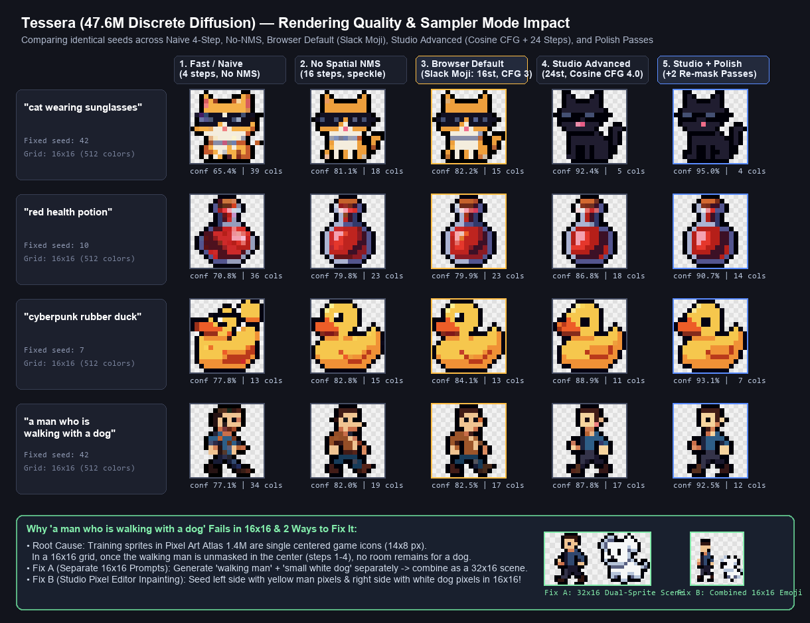

Sunday morning, coffee, Hugging Face's featured models. Today's pick was a pixel-art generator, and I got stuck on a dumb thought: 16×16 is 256 pixels, which is four chessboards. Then I read the architecture, and it turns out the middle of the network really does think on an 8×8 board.

This is my first post in six years. It's about [Tessera-small](https://huggingface.co/thejagstudio/tessera-small), a 47.6M-parameter model by Jagrat Patel, and its [in-browser ONNX port](https://huggingface.co/cfahlgren1/tessera-small-onnx) by `cfahlgren1`, which powers the [Slack Moji](https://huggingface.co/spaces/cfahlgren1/slack-moji) demo. The canvas is so small that you can count every pixel and watch quantization, sampling and training data each leave their mark.

*Same prompts and seeds, five sampler settings. Click for the full-size chart.*

## Four chessboards

Tessera is a masked diffusion model over discrete tokens. A 16×16 sprite is a 256-token sentence, and every pixel is one token from a learned 512-colour palette (token 0 means transparent), plus a `[MASK]` token. There's no VAE and no latent space.

To draw a sprite:

1. The prompt goes through a frozen CLIP ViT-B/32 text encoder, padded to 24 tokens.
2. The 24 text tokens and the 256 pixel tokens go into one bidirectional transformer with an hourglass layout: 2 blocks at full resolution, 8 blocks on 2×2 patch-merged tokens, then 2 more at full resolution. Merging 2×2 patches turns the 16×16 canvas into an 8×8 grid, so 8 of the 12 blocks literally work on a chessboard.
3. Starting from a canvas that is all `[MASK]`, the model predicts a colour distribution for every pixel at once. Over about 16 steps it commits the pixels it is most sure about and predicts the rest again.

Training was small too: 82,342 steps of 512 sprites, about 5.5 hours on one NVIDIA RTX PRO 6000 Blackwell. That's roughly one Sunday morning. On held-out data the model gets 78.8% of masked pixels right.

## Quantization: what actually shrinks

To run Tessera in a browser with no inference server, the ONNX port stores the weights as int8. The download drops from 224 MB (the fp16 export) to 115 MB. Both numbers include the CLIP text encoder: the int8 denoiser is 51 MB and the int8 text encoder is 64 MB. So if you multiply 47.6M parameters by 2 bytes, get about 95 MB and wonder about the gap, the gap is CLIP.

Some details from the port that I liked:

- Only storage is int8. Each weight matrix has one scale per output channel, and the weights are turned back into fp32 at inference time, so the math still runs in fp32.
- The convolution weights stay fp16, because per-channel int8 gave wrong WebGPU results for 4D conv weights in onnxruntime-web 1.22. That's only about 0.3M of the 47.5M denoiser parameters.
- `Pow(x, 2)` was rewritten as `x*x`, because the original could return NaN on some GPUs for negative inputs.

The outputs barely change. On 8 test prompts, the int8 build and the fp16 export pick the same top colour for 91–99% of pixels. The repo reports about 1 second for 4 sprites on a laptop with WebGPU. On my machine a batch took about 3 seconds.

So the precision of the weights isn't where image quality is won or lost. Sampling is.

## Sampling: where the quality goes

The chart runs the same prompts and seeds through five settings:

1. **Fast / naive:** 4 steps, no spatial NMS
2. **No NMS:** 16 steps, no spatial NMS
3. **Browser default** (what Slack Moji uses): 16 steps, guidance 3, with NMS
4. **Advanced:** 24 steps, guidance ramping up to 4.0 on a cosine curve
5. **Advanced + polish:** the same, plus two extra passes that re-mask and redraw the least confident 8% of pixels

The browser default is already a careful sampler. It commits the most confident pixels first on a cosine schedule, adds annealed Gumbel noise, and runs 3×3 non-maximum suppression, so neighbouring pixels that are both unsure don't get committed in the same step. Turning NMS off is what makes the first two columns speckle. With only 4 steps, too many neighbours lock in before they can see each other: the cat breaks into 39 colours and the rubber duck grows a second head.

At the other end, more steps and the polish passes clean up stray pixels. The health potion goes from 36 colours in naive mode to 23 at the default and 14 after polishing.

The chart also prints a confidence number under each sprite. It rises from 65–78% (naive) to 80–84% (default) to 91–95% (polished). Take that with a grain of salt: the polish passes redraw exactly the least confident pixels, so the average goes up partly by design. The colour counts and the pictures are the better evidence.

## Training: why "a man who is walking with a dog" has no dog

Even with 24 steps and polish, "a man who is walking with a dog" gives me a walking man and no dog. More sampling doesn't fix it, because the problem comes from training.

Tessera was trained for 30 epochs on [Pixel Art Atlas 1.4M](https://huggingface.co/datasets/Angais/pixel-art-atlas-1.4m). Those 1.4 million sprites don't come from old games. They were generated from text prompts with Krea 2 Turbo and a pixel-art LoRA, and almost every one shows a single centred subject. The dataset card also warns that the captions describe what the generator was asked to draw, and that colours, counts and other details may not match the picture. So the model saw plenty of prompts that mention two things, attached to pictures that often show one.

It isn't that the grid is too small. A 4-pixel stick man next to a 3-pixel dog would fit in 16×16. The model simply never learned to draw two subjects. My reading of what happens: once it commits to a centred figure in the first few steps, the rest of the canvas becomes background.

Two workarounds do get a dog, shown at the bottom of the chart. You can generate "walking man" and "small white dog" separately and put them side by side on a 32×16 canvas. Or you can use inpainting, which Tessera supports, and seed the left and right halves of the canvas with man and dog pixels.

## What I took away

int8 moved the model from a GPU server into a browser tab with almost no change in what it draws. Sampling choices (steps, NMS, re-masking) changed the pictures far more than quantization did. And neither can add something the training data never showed: in a world of single-subject 16×16 sprites, a man walking a dog is two sprites stitched together.

If you want to play with it yourself: Tessera-small is licensed CC BY-NC 4.0, so it's free for personal and research use with credit, but commercial use needs a separate licence from the author.
